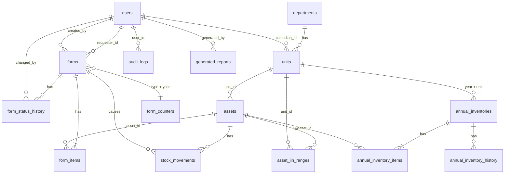

# Database Design and Laravel Plan

This document prepares the move from the browser prototype (`localStorage`) to a **Laravel** application with a database. It is based on the data the prototype already saves, so nothing here is new behavior: it is the same system with a real database.

---

## 1. What the prototype saves today, and where it goes

| Prototype (`localStorage`) | Laravel table |
|---|---|
| `forms` (each record has `header` and `items`) | `forms` + `form_items` |
| `forms[].statusHistory` | `form_status_history` |
| `forms[].signatures` | `form_signatures` |
| `formCounters` | `form_counters` |
| `users` | `users` |
| `assets` | `assets` |
| `auditLog` | `audit_logs` |
| `reportHistory` | `generated_reports` |
| `notifications` | `notifications` (Laravel's built-in table) |
| `units` | `departments` + `units` |
| `annualInventories` | `annual_inventories` + `annual_inventory_items` + `annual_inventory_history` |
| `assets[].iin` (ranges of numbers) | `asset_iin_ranges` |
| names printed in `Shared/print.js` (`SIGN`) | `signatories` |
| `sessionStorage`: `userEmail`, `userRole` | `auth()->user()` (Laravel session) |

---

## 2. Tables

Column types follow Laravel migrations. `nullable` means the column may be empty.

### `users`
Accounts that can log in (replaces the `users` key and the two hardcoded logins).

| Column | Type | Notes |
|---|---|---|
| id | bigint, PK | |
| name | string | |
| email | string, **unique** | login name |
| contact | string, nullable | |
| department | string, nullable | |
| role | string | `administrator`, `staff` or `requester` |
| status | string | `active` or `inactive` (default `active`) |
| password | string | **hashed** (never plain text) |
| remember_token, timestamps | | Laravel defaults |

### `forms`
One table for all three forms (Requisition, Pull-Out Request, Acknowledgment Receipt), because they share the same shape: a header, a list of lines, a status and a control number.

| Column | Type | Notes |
|---|---|---|
| id | bigint, PK | |
| type | string | `requisition`, `pullout` or `receipt` |
| control_no | string | for example `26-001` |
| year | smallint | 2-digit year used in the number (26) |
| sequence | unsigned int | the number part (1, 2, 3...) |
| status | string | `pending`, `approved`, `released`, `rejected` |
| requester_id | FK `users`, nullable | the Requester who owns the form. For a receipt: the Requester who receives it (empty if the person has no account) |
| created_by | FK `users` | who created it (Requester, or Admin for receipts) |
| header | **json** | type-specific header fields (see below) |
| total | decimal(12,2), default 0 | sum of item amounts (requisition only) |
| requisition_id | FK `forms`, nullable | for a receipt made for a released requisition |
| stock_applied | boolean, default false | the stock was already changed for this form (so it is never changed twice) |
| timestamps | | `created_at` is the "date submitted" |

Unique index: `(type, year, sequence)`. Index: `(requester_id, status)`.

**Content of `header` by type** (the same keys the prototype uses):

| type | header keys |
|---|---|
| requisition | `department`, `section`, `month` |
| receipt | `name`, `department` |
| pullout | `requestingParty`, `office`, `date`, `pulledOutBy`, `pulledDate`, `receivedBy`, `receivedDate` |

In the model: `protected $casts = ['header' => 'array'];`

> **Alternative:** instead of a JSON column, use one real column per header field (all nullable). That is easier to filter in SQL but makes the table wide. For this project the JSON column is simpler and mirrors the current code.

### `form_items`
The lines of a form. Columns that do not apply to a type stay empty.

| Column | Type | Used by |
|---|---|---|
| id | bigint, PK | |
| form_id | FK `forms`, cascade on delete | all |
| line_no | unsigned smallint | all (keeps the order on the paper) |
| name | string, nullable | requisition ("Name (Print Full Name)") |
| qty | decimal(10,2) | all |
| unit | string, nullable | requisition, receipt |
| item | string | requisition (*Particulars*), receipt (*Item*), pullout (*Item/s*) |
| description | string, nullable | receipt, pullout |
| unit_price | decimal(12,2), nullable | requisition |
| amount | decimal(12,2), nullable | requisition (`qty x unit_price`) |
| last_requested | date, nullable | requisition ("Date Last Requested") |
| received_by | string, nullable | requisition |
| reason | string, nullable | pullout |
| asset_id | FK `assets`, nullable | the item chosen from the inventory. Empty = free text (no stock effect) |

### `form_status_history`
Replaces `statusHistory`. One row for every change of status.

| Column | Type | Notes |
|---|---|---|
| id | bigint, PK | |
| form_id | FK `forms`, cascade on delete | |
| from_status | string, nullable | empty for the first status |
| to_status | string | |
| changed_by | FK `users` | |
| created_at | timestamp | |

### `form_signatures`
The three signatures of a **requisition**. The paper is signed by hand; this table records that the Property Office received each signature.

| Column | Type | Notes |
|---|---|---|
| id | bigint, PK | |
| form_id | FK `forms`, cascade on delete | only for `type = requisition` |
| signer | string | `dean`, `auditing` or `custodian` |
| recorded_by | FK `users` | who ticked it (Staff or Administrator) |
| signed_at | timestamp | when it was recorded |

Unique index: `(form_id, signer)`. Removing a signature (an Administrator only) deletes the row, and it is written in `audit_logs`.

### `form_counters`
Replaces `formCounters`. Gives the next control number safely when two people save at the same time.

| Column | Type | Notes |
|---|---|---|
| id | bigint, PK | |
| type | string | |
| year | smallint | |
| last_number | unsigned int | last number used |

Unique index: `(type, year)`.

### `departments` and `units` (Sections / Units)
A **unit** is a place with a code and a person responsible for it, for example code `MRm102`, department DISD, "Computer Lab / Room 102".

`departments`

| Column | Type | Notes |
|---|---|---|
| id | bigint, PK | |
| name | string, **unique** | for example `DISD`, `Registrar` |
| timestamps | | |

`units`

| Column | Type | Notes |
|---|---|---|
| id | bigint, PK | |
| department_id | FK `departments` | |
| code | string, **unique** | letters, numbers and hyphens. It is the prefix of the IIN. Cannot change once items have numbers |
| name | string | the Section / Unit, for example "Computer Lab / Room 102" |
| custodian_id | FK `users`, nullable | the Requester who is responsible (the custodian) |
| job_title | string, nullable | job title of the custodian, printed in the report |
| next_iin | unsigned int, default 1 | the next IIN number of the unit. It only goes up (a number is never used again) |
| timestamps | | |

### `assets`
The inventory. There are two types of items (see *Consumable and non-consumable* below).

| Column | Type | Notes |
|---|---|---|
| id | bigint, PK | |
| asset_code | string, **unique** | `AST001`, `AST002`... |
| type | string | `consumable` or `non_consumable` |
| name | string | |
| category | string | Electronics, Equipment, Furniture, Office Supplies, Audio Device, Other |
| unit | string | pc, ream, box... |
| unit_price | decimal(12,2), nullable | fills the price of a requisition line |
| quantity | decimal(10,2) | consumable: **stock on hand**. Non-consumable: **total owned** |
| reorder_level | decimal(10,2), default 0 | consumable only. Low stock when `quantity <= reorder_level` |
| issued_qty | unsigned int, default 0 | non-consumable only: units given to a person |
| maintenance_qty | unsigned int, default 0 | non-consumable only: units pulled out (repair...) |
| brand, model | string, nullable | non-consumable |
| serial_number | string, **unique**, nullable | non-consumable |
| condition | string, nullable | New, Good, Fair, Poor, Damaged (non-consumable) |
| unit_id | FK `units`, nullable | the Section / Unit of a non-consumable item |
| make, color, size | string, nullable | description of the paper form (Make, Color, Size) |
| remarks | string, nullable | for example "1 running, 1 disconnected" |
| date_assigned | date, nullable | the Date column of the Annual Inventory |
| location | string | filled with the name of the unit when it is empty |
| photo_path | string, nullable | file in `storage/app/public` (not the image itself in the database) |
| timestamps | | |

**Not stored:** the status. It is worked out (a model accessor), so it can never disagree with the numbers:
- Non-consumable: `available = quantity - issued_qty - maintenance_qty`. Status is *Available* if `available > 0`, else *Issued* if `issued_qty > 0`, else *Maintenance*.
- Consumable: *Out of Stock* if `quantity <= 0`, *Low Stock* if `quantity <= reorder_level`, else *In Stock*.

Add a database check so that `issued_qty + maintenance_qty <= quantity`.

### `stock_movements`
A history of every change of stock, so a number can always be explained. The prototype only writes these changes in the Audit Trail.

| Column | Type | Notes |
|---|---|---|
| id | bigint, PK | |
| asset_id | FK `assets` | |
| form_id | FK `forms`, nullable | the form that caused it (empty for a manual change) |
| movement | string | `issue`, `pullout`, `return`, `repair_done`, `restock`, `adjustment` |
| quantity | decimal(10,2) | how many |
| balance_after | decimal(10,2) | stock (consumable) or available units (non-consumable) after the change |
| user_id | FK `users` | |
| note | string, nullable | |
| created_at | timestamp | |

### `asset_iin_ranges`
The IIN numbers of an item. An item can have more than one range (for example `MRm102-217-218` and `MRm102-223-224`) when its quantity went up later.

| Column | Type | Notes |
|---|---|---|
| id | bigint, PK | |
| asset_id | FK `assets`, cascade on delete | |
| unit_id | FK `units` | the unit the numbers belong to |
| first_no, last_no | unsigned int | the range, for example 6 and 46 for `MRm102-006-046` |

The IIN text is built, not stored: `units.code + "-" + first_no (3 digits) + "-" + last_no`, or only `first_no` when both are equal. Check that the ranges of one unit never overlap: `unique(unit_id, first_no)` and a transaction that reads `units.next_iin` with `lockForUpdate()`.

### `annual_inventories`
The yearly report of a unit: a **snapshot**, so it does not change when the assets change later.

| Column | Type | Notes |
|---|---|---|
| id | bigint, PK | the readable code is `AI-2026-MRm102` (`AI-` + year + unit code) |
| year | smallint | |
| unit_id | FK `units` | **unique** with `year` |
| status | string | `draft`, `verified` or `certified` |
| code, department, section, job_title | string | copies of the unit at the time (so the paper does not change if the unit is edited) |
| custodian_id | FK `users`, nullable | |
| custodian_name | string | copy of the name printed in the report |
| created_by, verified_by, certified_by | FK `users`, nullable | |
| verified_at, certified_at | timestamp, nullable | |
| custodian_certified_by | FK `users`, nullable | the online certification of the custodian |
| custodian_certified_at | timestamp, nullable | |
| timestamps | | |

### `annual_inventory_items`
The lines of the report (copied from the assets, then counted).

| Column | Type | Notes |
|---|---|---|
| id | bigint, PK | |
| annual_inventory_id | FK, cascade on delete | |
| line_no | unsigned smallint | order of the lines |
| asset_id | FK `assets`, nullable | empty for a line added during the count |
| iin | string | the IIN text at that time |
| date | date, nullable | |
| qty | decimal(10,2) | the quantity in the records |
| counted_qty | decimal(10,2) | the quantity counted. **This is the quantity printed.** |
| unit | string | |
| item, brand, model, make, color, size, serial | string | |
| unit_price | decimal(12,2) | `amount = counted_qty x unit_price` |
| remarks | string, nullable | |
| is_manual | boolean | a line added during the count |

### `annual_inventory_history`
Every step of a report.

| Column | Type | Notes |
|---|---|---|
| id | bigint, PK | |
| annual_inventory_id | FK, cascade on delete | |
| status | string | the status after the step |
| note | string, nullable | for example "Certified by the custodian", "Reopened" |
| user_id | FK `users` | |
| created_at | timestamp | |

### `audit_logs`
Replaces `auditLog`. Rows are only added, never edited or deleted.

| Column | Type | Notes |
|---|---|---|
| id | bigint, PK | the Log ID (`LOG001`) can be built from it |
| user_id | FK `users`, nullable | |
| user_email | string | copy of the email, so the log stays readable if the user is deleted |
| role | string | |
| activity | string | for example `Approved Requisition 26-001 (Pending > Approved)` |
| created_at | timestamp | date and time |

### `generated_reports`
Replaces `reportHistory`. Only the **settings** of a report are saved. The report itself is built again from the current data each time.

| Column | Type | Notes |
|---|---|---|
| id | bigint, PK | the Report ID (`RPT001`) can be built from it |
| type | string | Request, Requisition Cost, Issuance, Audit Trail, Inventory, User |
| date_from | date, nullable | |
| date_to | date, nullable | |
| prepared_by | string | |
| generated_by | FK `users` | |
| created_at | timestamp | |

### `signatories`
The names printed in the signature boxes (now written inside `print.js`). Having them in a table lets the Admin change them when the people change.

| Column | Type | Notes |
|---|---|---|
| id | bigint, PK | |
| key | string, **unique** | `school_auditor`, `property_custodian` |
| name | string | `RAYMUND S. PAGADUAN`, `NELSON F. SALISI` |
| title | string | `SCHOOL AUDITOR`, `PROPERTY CUSTODIAN` |

---

## 3. Relationships

---

### QR codes

The QR codes need **no new column**. They are built from data that already exists:

| QR of | Text inside (prototype) | Taken from |
|---|---|---|
| an asset | `NEU-CMS\|ASSET\|AST001` | `assets.asset_code` |
| a form | `NEU-CMS\|FORM\|requisition\|26-001` | `forms.type` + `forms.control_no` |

In Laravel the QR can hold a **signed URL** instead, for example `https://your-site/admin/requests/lookup?type=requisition&no=26-001` (or `/admin/assets/AST001`), so that a phone camera opens the page directly. Keep the Admin-only protection on those routes, so a scanned code is useless to someone who is not logged in as Admin.

---

### Notifications and realtime

The bell and the live updates of the prototype become **Laravel Notifications + Broadcasting**.

**Table `notifications`** (created with `php artisan notifications:table`, nothing to design):

| Column | Notes |
|---|---|
| id | uuid |
| type | the notification class |
| notifiable_type, notifiable_id | the user who receives it |
| data | json: `message`, and the form (`type`, `control_no`) to open |
| read_at | empty = unread. Replaces the `readBy` list of the prototype |
| timestamps | |

**Who is notified (same as the prototype)**

| Event | Receives |
|---|---|
| A Requester submits a form | all active Administrators |
| A Requester deletes a pending form | all active Administrators |
| The Admin approves, releases or rejects a form | the Requester who owns it (`forms.requester_id`) |

**Broadcasting.** Use **Laravel Reverb** (the official WebSocket server) with **Laravel Echo** in the browser. Create two events, `FormSubmitted` and `FormStatusChanged`, and broadcast them on **private channels** so a user only receives his or her own: `private-admins` (only users with the administrator role) and `private-users.{id}`. In the page, the function that the prototype calls `onDataChange(...)` becomes an Echo listener that reloads the same list or counters.

If WebSockets are too much for the project, **polling** (asking the server every few seconds) gives the same result with less setup.

---

### Consumable and non-consumable

The type belongs to the **asset**, not to the form: a Requisition can ask for bond paper (consumable) or a laptop (non-consumable); an Acknowledgment Receipt documents either; a Pull-Out Request is only for non-consumable items.

When stock changes (all inside **one database transaction**, with `lockForUpdate()` on the asset rows so two Admins cannot take the same stock):

| Event | Consumable | Non-consumable |
|---|---|---|
| Requisition `released` | `quantity -= qty` | `issued_qty += qty` |
| Receipt made without `requisition_id` | `quantity -= qty` | `issued_qty += qty` |
| Receipt with `requisition_id` of a released requisition | no change | no change |
| Pull-Out `released` | not allowed | `issued_qty -= min(issued_qty, qty)` first, then the rest comes from the available units; `maintenance_qty += qty` |

The check comes **before** the change: if any line is not possible, nothing changes and the form stays as it was. After the change, set `forms.stock_applied = true` and write a row in `stock_movements`. Correcting the Issued count, finishing a repair and restocking are manual changes of the asset, and also write a movement.

### Roles and permissions

`users.role` is `administrator`, `staff` or `requester`. The Administrator and Staff use the **same pages** (the admin area); the difference is in the permissions, checked with **Policies / Gates** on the server (hiding the button is not enough):

| Permission | Administrator | Staff |
|---|---|---|
| Prepare receipts, add and edit assets, import items, manage Sections / Units, count the Annual Inventory, scan, reports | yes | yes |
| Approve, release or reject a request | yes | **no** |
| Record the signatures of a requisition | yes | yes (removing one: Administrator only) |
| Delete an asset, a unit, or a draft Annual Inventory | yes | **no** |
| Certify (lock) or reopen an Annual Inventory | yes | **no** |
| Users, Audit Trail, User Report, Audit Trail Report | yes | **no** |

A Requester sees only his or her own forms, receipts, notifications and Annual Inventories (`requester_id` / `custodian_id`).

### Annual Inventory

- Statuses and who can do each step: `draft` -> `verified` (Staff or Administrator; notifies the custodian) -> `certified` (**Administrator**; notifies the custodian). A `certified` report is read-only. **Reopen** (Administrator) goes back to `draft` and clears the certifications.
- The custodian can add an **online certification** (`custodian_certified_at`) only while the report is `verified`. It does not change the status and it notifies the administrators. `draft` reports are hidden from the custodian.
- One report per `(year, unit)`. Creating it copies the non-consumable assets of the unit (only if the unit has some) into `annual_inventory_items`, ordered by IIN.
- The report is a snapshot: later changes to assets or to the unit do not change it.
- Import from Excel: validate **all** the rows first (item, qty of 1 or more, the unit exists, valid date and price, new serial numbers) and import in **one transaction**. If a row fails, nothing is saved.

---

## 4. Rules to keep (already working in the prototype)

**Forms**
- A Requester can create **Requisition** and **Pull-Out Request** forms. Only the Admin creates **Acknowledgment Receipts**, and they start as `released`.
- New forms start as `pending`.
- Allowed changes of status (**Administrator only**):
  `pending -> approved` or `rejected`, `approved -> released` or `rejected`. `released` and `rejected` are final.
- **Signatures (requisition only):** after `approved`, the Property Office (Staff or Administrator) records the three signatures `dean`, `auditing`, `custodian` in `form_signatures`. The form **cannot become `released` until the three exist** (check it in the Policy and again in the database transaction that releases it). Each signature notifies the requester. Only an Administrator can remove a signature, and only while the form is `approved`.
- A Requester can delete a form only while it is `pending`.
- A Requester sees only his or her own forms (`requester_id`). This replaces the email comparison used in the prototype.
- A form needs at least one item, and every item needs a quantity and an item/particulars.
- `amount = qty x unit_price`, and `total` is the sum of the amounts.

**Control numbers**
- Format `yy-001`. Each form type has its own sequence, and every year starts again at 001.
- A deleted form never gives its number back.
- Create the number **inside a database transaction**, locking the `form_counters` row (`lockForUpdate()`), so two forms never get the same number.

**Users**
- The email must be unique.
- An `inactive` user cannot log in.
- The Admin cannot delete his or her own account.
- The system must always keep at least one active Administrator.
- Password: at least 6 characters, always hashed.

**Assets**
- The serial number, when given, must be unique.
- Non-consumable: the total quantity is at least 1, and `issued + maintenance` is not more than the total.
- Consumable: the stock is 0 or more.
- A form cannot be released if the stock is not enough. A Requester only gets a warning when submitting.

**Reports**
- Rejected requisitions are not counted in the cost totals.
- Passwords are never printed.

**Audit trail**
- Write a row for: login, submitting a form, deleting a form, every change of status, issuing a receipt, adding/updating/deleting a user or an asset, and generating a report.

---

## 5. Pages, routes and who can open them

Role protection (middleware) replaces the missing protection of the prototype: a Requester must not open an Admin route, and the other way around.

**Requester** (`role:requester`)

| Page | Route | Notes |
|---|---|---|
| Dashboard | `GET /requester/dashboard` | |
| Request | `GET /requests`, `POST /requests` | create Requisition or Pull-Out |
| (delete a pending form) | `DELETE /requests/{form}` | only if `pending` and owned |
| My Requests | `GET /my-requests` | |
| History | `GET /history` | status `released` or `rejected` |
| Print a form | `GET /forms/{form}/print` | only own forms |
| My Inventory | `GET /my-inventory`, `GET /my-inventory/{annual}` | only the reports of the units where the user is the custodian, and not `draft` |
| Certify (custodian) | `POST /my-inventory/{annual}/certify` | only if `verified` and not certified yet |
| Print the Annual Inventory | `GET /annual-inventories/{annual}/print` | only own |

**Administrator and Staff** (`role:administrator,staff`). Where a row says *Administrator only*, a Staff user gets `403`.

| Page | Route | Notes |
|---|---|---|
| Dashboard | `GET /admin/dashboard` | |
| Request Management | `GET /admin/requests`, `GET /admin/requests/{form}` | |
| Change status | `PATCH /admin/requests/{form}/status` | follows the allowed changes above. **Administrator only**. `released` needs the three signatures |
| Record or remove a signature | `PUT /admin/requests/{form}/signatures/{signer}`, `DELETE ...` | record: Staff and Administrator, only while `approved`. Remove: **Administrator only** |
| Issuance | `GET /admin/issuance`, `POST /admin/issuance` | Acknowledgment Receipts |
| Assets | `resource /admin/assets` | |
| Asset import | `POST /admin/assets/import` | the whole table is validated first |
| Annual Inventory | `resource /admin/annual-inventories`, `PATCH .../{annual}/verify`, `.../back-to-draft` | Staff and Administrator |
| Certify, reopen, delete a draft | `PATCH .../{annual}/certify`, `.../reopen`, `DELETE .../{annual}` | **Administrator only** |
| Sections / Units | `resource /admin/units` | delete: **Administrator only**, and only when the unit has no items and no report |
| Print the Annual Inventory | `GET /annual-inventories/{annual}/print` | any |
| Users | `resource /admin/users` | **Administrator only** |
| Reports | `GET /admin/reports`, `POST /admin/reports` | the POST saves the settings and opens the printable report |
| Audit Trail | `GET /admin/audit-trail` | read-only. **Administrator only** |
| Print a form | `GET /forms/{form}/print` | any form |

**Login:** the prototype has two login pages. In Laravel this can stay as two pages, or become one login that sends the user to the right dashboard according to the role. Keep the rule that an Admin account cannot enter through the Requester login and the other way around, or simplify it to one login.

---

## 6. How to convert the pages

Two ways to use the existing pages:

| | A. Blade views (recommended) | B. Keep the HTML and call an API |
|---|---|---|
| Idea | Each `.html` becomes a Blade view. Laravel prepares the data. | The `.html` pages stay. `fetch()` calls JSON routes. |
| Login and route protection | Built in (Laravel Breeze and middleware) | Needs Sanctum and more setup |
| Reuse of the prototype | CSS and layout are reused. JavaScript for tables and storage is replaced by Blade and controllers. | HTML, CSS and most JavaScript are reused. Only the `localStorage` functions change. |
| Printing | The print layouts become Blade partials, reusing `print.css` | `print.js` stays as it is |
| Fit for a school project | Better: simpler to explain and to protect | More moving parts |

In the prototype, all `localStorage` access is in a few functions per page (`loadAll`, `saveAll`, `loadUsers`, `loadAssets`, `addAuditLog`...). Those are the only places that change in either option.

---

## 7. Suggested order of work

1. Create the Laravel project and install **Laravel Breeze** (login). Add the `role` and `status` columns to `users`.
2. Create the migrations in this order: `users` -> `assets` -> `signatories` -> `form_counters` -> `forms` -> `form_items` -> `form_status_history` -> `audit_logs` -> `generated_reports`.
3. Seeders: the two starting accounts (`admin@neu.edu.ph`, `requester@neu.edu.ph`) and the two signatories. Use new passwords, hashed.
4. Role middleware and the login redirect by role.
5. Requester side: Request (create and print), My Requests, History, Dashboard.
6. Admin side: Request Management (status changes and the status history), then Issuance.
7. Assets and Users.
8. Audit log (write it from one place, for example an `AuditLog::record()` helper or model events), then the Audit Trail page.
9. Reports and Dashboard (counts and the chart come from database queries).
10. Roles: add `staff` to `users.role`, and write the Policies / Gates of the table *Roles and permissions* (do it before the pages, so every page starts with the right rules).
11. Sections / Units, the new asset columns, `asset_iin_ranges` and the IIN allocation (in a transaction), then the import.
12. Annual Inventory: the three tables, the statuses and the *Annual Inventory* rules, the print view (a Blade view with the paper layout), and the custodian's *My Inventory*.
13. Stock: the rules in *Consumable and non-consumable*, with the `stock_movements` table. Do this together with step 6 (Request Management), because releasing a form changes the stock.

The prototype data does not need to be moved, because it only contains test data.
